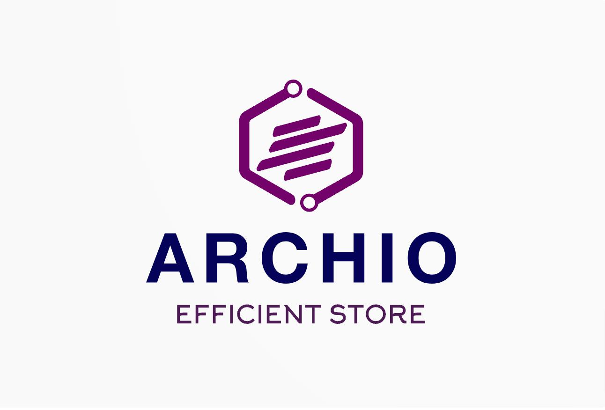

<p align="center">
  
</p>

# Archio

Archio is a Go-based HTTP server that stores objects in buckets through a JSON REST API. It has no visual interface and is not S3-compatible. Every upload creates a new immutable version, and every version has exactly one public read URL.

## Prerequisites

- Go (1.25.6+)
- Docker (optional, for containerization)

## Getting Started

### 1. Setup Environment

First, duplicate the example environment variables file and update it with your desired configuration:

```bash
cp .env.example .env
```

### 2. Install Dependencies

Download the required Go modules:

```bash
go mod download
```

## Running Locally

Start the local dependencies with Docker Compose:

```bash
docker compose up -d
```

The Compose stack provides PostgreSQL with the `vector` extension enabled, Redis, and RabbitMQ. PostgreSQL data, Redis data, and RabbitMQ data persist in named Docker volumes. RabbitMQ's management UI is available at `http://127.0.0.1:15672`.

Compose also defines an `api` service built from the `Dockerfile`. `docker compose up -d --build` starts the whole stack with the API on `http://127.0.0.1:3000`, and object bytes persist in the `object_data` volume. To run only the dependencies and the API on your host, use `docker compose up -d postgres redis rabbitmq`.

Note: the group, API key and object version schema change requires a fresh database volume. Reset local data with `docker compose down -v` before starting the stack (this deletes the database, Redis, RabbitMQ and `object_data` volumes).

Copy `.env.example` to `.env` to use the matching local connection settings, then start the server during local development:

```bash
go run ./cmd/api
```

At startup, Archio opens PostgreSQL, Redis, and RabbitMQ, enables pgvector if needed, and applies the Ent schema. `/health` is a readiness check: it returns HTTP 200 when all three services are reachable and HTTP 503 otherwise, with a per-service status and no raw connection errors. If `.env` specifies `RUN_MODE=development`, a `statsviz` visualization dashboard is available.

After changing an Ent schema, regenerate the client and migration definitions:

```bash
go generate ./internal/ent
```

Stop the dependencies with `docker compose down`. To remove their persisted data as well, run `docker compose down -v`.

- **Health Check endpoints**: `http://127.0.0.1:3000/health`
- **Metrics Dashboard**: `http://127.0.0.1:3000/debug/statsviz/`

## Configuration

Copy `.env.example` to `.env`. Besides the application, database, Redis and broker settings, the object storage API uses:

| Variable | Required | Description |
|---|---|---|
| `ROOT_USERNAME`, `ROOT_PASSWORD` | yes | Root credentials for the admin endpoints (HTTP Basic auth). |
| `STORAGE_PATH` | yes | Directory where object bytes are stored, for example `./data/objects` on the host. Created at startup if missing. |
| `PUBLIC_BASE_URL` | no | Base URL used to build `readUrl` values. Defaults to `http(s)://APP_HOST:APP_PORT`. |
| `MAX_UPLOAD_BYTES` | no | Maximum upload size in bytes. Defaults to `5368709120` (5 GiB). |

The Compose `api` service sets `STORAGE_PATH=/data/objects`, `PUBLIC_BASE_URL` and the service hostnames itself. `.env` is optional for it, but `ROOT_USERNAME` and `ROOT_PASSWORD` must come from `.env` or your shell.

## API Overview

All responses are JSON except object downloads. Errors look like `{"error": {"code": "bucket_not_found", "message": "..."}}`.

Admin endpoints use HTTP Basic auth with the root credentials. Every other `/v1` endpoint uses `Authorization: Bearer <api-key>`. A key belongs to one group and can reach only that group's buckets. Anything in another group returns `404`. The only exception is the read URL `GET /v1/objects/{versionId}`, which is public: anyone holding the URL can download that version, so share read URLs only with people who should have the content.

| Method and path | Auth | Description |
|---|---|---|
| `POST /v1/admin/groups` | Basic | Create a group `{name}`. |
| `GET /v1/admin/groups` | Basic | List groups: `{"groups":[...]}`. |
| `DELETE /v1/admin/groups/{groupId}` | Basic | Delete a group (`409` while it has buckets). |
| `POST /v1/admin/groups/{groupId}/keys` | Basic | Issue a key `{name}`. The plaintext key is returned only once. |
| `GET /v1/admin/groups/{groupId}/keys` | Basic | List keys: `{"keys":[...]}`. |
| `DELETE /v1/admin/groups/{groupId}/keys/{keyId}` | Basic | Revoke a key. |
| `POST /v1/buckets` | Key | Create a bucket `{name, description?}`. Names are unique across the instance. |
| `GET /v1/buckets` | Key | List the group's buckets. |
| `GET /v1/buckets/{bucket}` | Key | Bucket details. |
| `DELETE /v1/buckets/{bucket}` | Key | Delete an empty bucket. |
| `PUT /v1/buckets/{bucket}/objects/{key...}` | Key | Upload the raw body as a new version. Returns `201` with the version and its `readUrl`. |
| `GET /v1/buckets/{bucket}/objects?prefix=&limit=&cursor=` | Key | List objects with their current version. |
| `GET /v1/buckets/{bucket}/versions/{key...}` | Key | List all versions of an object, newest first. |
| `DELETE /v1/buckets/{bucket}/objects/{key...}` | Key | Delete the object and all its versions. |
| `GET`/`HEAD /v1/objects/{versionId}` | Public | Download one version. No key needed. Supports `Range` and `If-None-Match`. |

After each upload, Archio publishes `object.version.created` on the durable topic exchange `archio.events`.

### Quickstart

With the stack running and `ROOT_USERNAME=root` and `ROOT_PASSWORD=secret`:

```bash
# Create a group and an API key (the key is shown only once)
curl -s -u root:secret -X POST http://127.0.0.1:3000/v1/admin/groups -d '{"name":"team-a"}'
curl -s -u root:secret -X POST http://127.0.0.1:3000/v1/admin/groups/<groupId>/keys -d '{"name":"laptop"}'

export KEY=ak_...

# Create a bucket and upload two versions of an object
curl -s -H "Authorization: Bearer $KEY" -X POST http://127.0.0.1:3000/v1/buckets -d '{"name":"my-bucket"}'
curl -s -H "Authorization: Bearer $KEY" -H 'Content-Type: text/plain' -X PUT --data-binary 'v1' http://127.0.0.1:3000/v1/buckets/my-bucket/objects/doc.txt
curl -s -H "Authorization: Bearer $KEY" -H 'Content-Type: text/plain' -X PUT --data-binary 'v2' http://127.0.0.1:3000/v1/buckets/my-bucket/objects/doc.txt

# List versions, then download one through its public readUrl (no key needed)
curl -s -H "Authorization: Bearer $KEY" http://127.0.0.1:3000/v1/buckets/my-bucket/versions/doc.txt
curl -s <readUrl>
```

## Building from Source

To compile the application into a standalone executeable binary:

```bash
go build -o archio-api ./cmd/api
```

Run the binary:
```bash
./archio-api
```

## Running with Docker

A `Dockerfile` is provided that uses a multi-stage build to package the application efficiently.

### 1. Build the Docker Image

```bash
docker build -t archio-api .
```

### 2. Start the Docker Container

Provide your `.env` file to the container to pass the required configuration (it must point at reachable PostgreSQL, Redis and RabbitMQ hosts and set `STORAGE_PATH`), and bind the application port to your host machine. Mount a volume at the storage path to keep object bytes:

```bash
docker run -p 3000:3000 --env-file .env -v archio_objects:/data/objects archio-api
```
